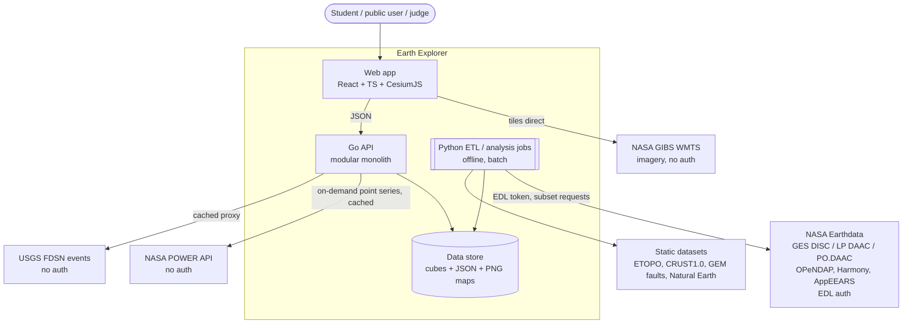
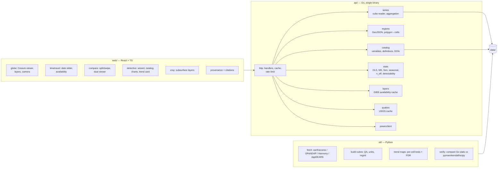
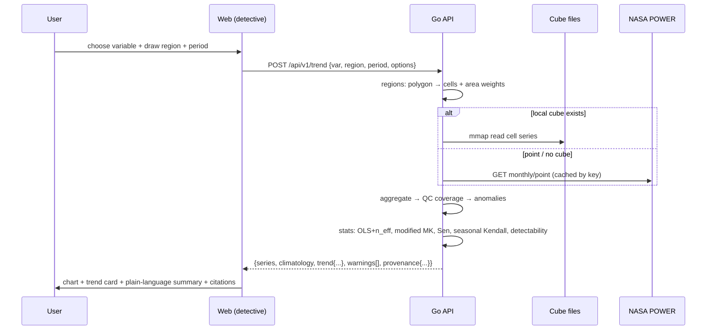
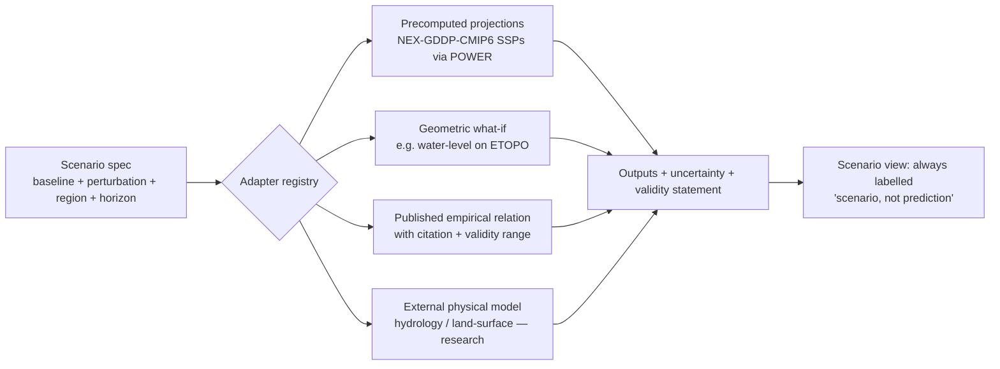
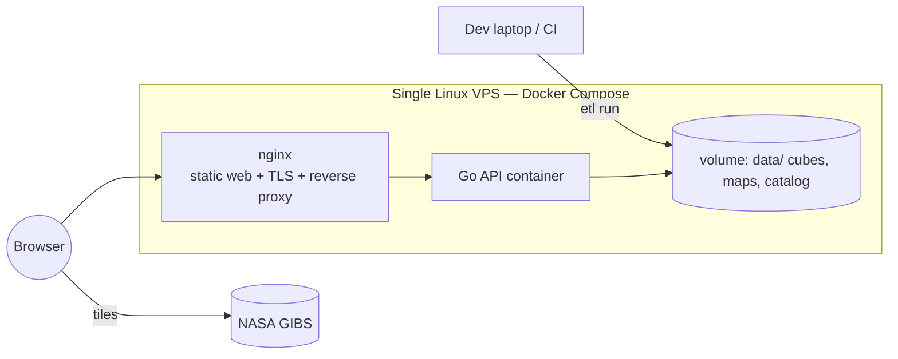

# Architecture — Earth Explorer

Style: **modular monolith**.

- One Go API binary with internal modules.
- One React/TypeScript/CesiumJS single-page app.
- One Python ETL/analysis toolkit that runs offline as batch jobs, **not** as a long-running service in the MVP.
- No microservices, no message broker, no Kubernetes.

Statements about CesiumJS APIs below come from general knowledge of the library and are marked **[TO VERIFY]** where the exact API was not checked in this session.

---

## 1. System context



Design decisions:

1. **The browser fetches GIBS tiles directly.** They are public and CDN-served. Proxying would only add cost.
2. **EDL credentials live only in the ETL environment.** The browser never sees them.
3. **Heavy science runs offline.** Global per-cell trend maps are precomputed. Regional trends are computed on demand in Go from local cubes, which takes milliseconds.
4. **POWER is the "any point on Earth" fallback.** Where no local cube exists, or the user asks for a point, the API calls POWER (MERRA-2-based) and caches the response.

## 2. Containers and modules



Proposed repository layout (to be created only in the build phase):

```
earth-explorer/
  web/                 React + TS + CesiumJS (Vite)
  api/                 Go module: cmd/server, internal/{catalog,regions,series,stats,layers,quakes,powerclient,httpx}
  etl/                 Python package + CLI (uv/pip), jobs per dataset
  data/                git-ignored: cubes/, maps/, catalog.json, regions/
  docs/
  docker-compose.yml   web (nginx static) + api; etl as a one-off "profile"
```

## 3. Data storage design

There is no database in the MVP. Files are simpler, reproducible, and fit the "ordinary hardware" constraint.

| Artefact | Format | Produced by | Read by |
|---|---|---|---|
| `catalog.json` | JSON: variable id, plain definition, unit, product, version, DOI, kind, native res, period, cube path | hand-curated + ETL | Go `catalog` |
| **Cubes** `cubes/{var}/{grid}.bin` + `.json` header | **cell-major float32** (`[lat][lon][time]`, NaN = missing) + JSON (grid, time axis, units, provenance) | ETL | Go `series` (memory-mapped) |
| Trend maps `maps/{var}/{period}/slope.png`, `sig.png`, `stats.json` | Equirectangular PNG plus legend metadata | ETL | Web (Cesium single-tile imagery) |
| Regions `regions/*.geojson` | Natural Earth admin-0/1 (public domain [ASSUMPTION]) + user-drawn | ETL / user | Go `regions`, Web |
| Static subsurface | ETOPO 60″ GeoTIFF, CRUST1.0 grids → JSON/bin, GEM faults GeoJSON | ETL | API / Web |

Why cell-major float32: to aggregate a region, read each overlapping cell's whole time series as one contiguous slice. Cubes for a 0.5° global grid × 550 months are ≈ 0.57 GB per variable; regional 0.05° cubes are small. Memory-mapped reads keep RAM low. This matters on this machine because of the OOM history.

**When to add PostGIS (post-MVP):** user accounts and saved investigations, many polygon regions (watersheds), spatial joins over vector data (faults, events), or concurrent multi-user writes. Not before.

## 4. Key request flow — regional trend



API surface (MVP, versioned):

```
GET  /api/v1/catalog                      variables + definitions + provenance
GET  /api/v1/catalog/search?q=&biome=     guided search
GET  /api/v1/regions                      preset regions
POST /api/v1/series                       {var, region, period} → aggregated series
POST /api/v1/trend                        series + trend results (see SCIENTIFIC_METHODS §13)
POST /api/v1/compare                      two regions or two variables
GET  /api/v1/maps/{var}/{period}          trend-map metadata + PNG URLs
GET  /api/v1/layers/{gibsLayer}/dates     cached GIBS DescribeDomains availability
GET  /api/v1/quakes?bbox=&minmag=&start=  cached USGS proxy (paged under 20,000)
```

## 5. Module designs

### A. Earth Globe

- **CesiumJS** Viewer. The base imagery is a GIBS WMTS layer (EPSG:3857 or 4326 `best` endpoint, for example `BlueMarble_ShadedRelief_Bathymetry` or a true-colour layer). Use Cesium's `WebMapTileServiceImageryProvider` with GIBS `TileMatrixSet` names. [TO VERIFY: exact matrix-set names per layer from GetCapabilities]
- **Terrain:** default `EllipsoidTerrainProvider` (no dependency) **or** self-served terrain built from ETOPO 2022 (open). Cesium World Terrain is an **optional toggle** (Cesium ion token, free-tier limits, proprietary service; see RISKS R-C2).
- **3D buildings:** optional OSM-based buildings where licensing allows. Off by default and labelled "current buildings, not historical".
- **Progressive loading:** Cesium's quadtree tile LOD handles this. Keep the max imagery level per layer equal to the source resolution, so a 2 km MERRA-2 tile is never shown "sharper" than its ~50 km data. Show a **"data resolution" badge** for each active layer.
- **Missing data:** GIBS returns empty or transparent tiles outside coverage. The legend shows "no data" explicitly, and the API's `layers/dates` tells the UI which dates exist.
- **Caching:** browser HTTP cache for tiles. Go in-memory LRU plus disk cache for POWER, USGS and GIBS DescribeDomains responses. Static assets go through nginx with long cache headers.

### B. Time Travel

- One global `currentDate` in app state drives all time-enabled GIBS layers. Each layer snaps to its **own** valid dates (daily, 8-day, monthly, yearly), using the availability list from `layers/dates`.
- Unavailable date → the layer shows "nearest available: YYYY-MM-DD (Δ days)". **Never** silently substitute.
- Playback: step through the valid dates of the slowest active layer, preloading the next frame.
- Each layer card shows the source, product version, data resolution vs tile resolution, and the observation kind (imagery vs data).
- **Historical honesty rule:** 3D buildings and terrain are present-day. When the date is not today, show a banner: "3D buildings show present-day structures; imagery is from {date}."

### C. Earth Compare

- **Swipe mode** (same globe, two imagery layers): Cesium `ImageryLayer.splitDirection` plus `scene.splitPosition`. [TO VERIFY: API names]
- **Side-by-side mode:** two Viewers with camera sync (copy `camera.position/direction/up` on the `camera.changed` event, with throttling). It can show different dates **or** different variables.
- **Numerical summary:** for the current region, call `/api/v1/compare`. It returns the mean difference between the two periods (with a two-sample test on anomalies, labelled descriptive) and the trend of each variable. Image pixels are never differenced; only data cubes are.

### D. Earth Trend Detective (competition-critical)

- **Wizard ("Detective")**, 3–4 questions:
  1. *What* — a theme: heat, water, snow and ice, vegetation, air quality, atmosphere aloft.
  2. *Where* — search a place, pick a preset, or draw a region.
  3. *When* — the default is the longest common period.
  4. *Compare with* — optional second region or variable.
- Answers filter `catalog` by tags (theme, biome, land/ocean, atmosphere level).
- **Optional SI helper:** turns a free-text question into catalog filter tags. **Constrained to catalog IDs.** It never produces numbers. It is logged so the team can describe it in the submission (an official requirement).
- **Results view:**
  - raw series plus climatology plus anomaly chart with the trend line and CI band
  - a trend card with slope/decade, CI, p-values for OLS-adj, modified MK and seasonal Kendall, n and n_eff, and a verdict badge
  - a detectability estimate
  - warnings (resolution, coverage, data kind)
  - a provenance and citation drawer
- **Map view:** precomputed global trend map (diverging slope, with FDR stippling) for the same variable and period, with the user's region outlined. This answers "where".
- **Demo mode:** scripted tours (camera path + wizard answers + narration text) for 2–3 investigations.

### E. X-Ray Earth (post-MVP design)

Three explicitly separated tiers, each with a visible badge:

| Tier | Content | Badge |
|---|---|---|
| **Observation** | USGS hypocentres as 3D points at depth (colour = depth, size = magnitude); ETOPO seafloor relief | "Observed (catalog / survey + interpolation)" |
| **Scientific model** | CRUST1.0 layer boundaries (sediment, crust, Moho) as surfaces below the globe; user-drawn **cross-section line** → a vertical profile panel (2D chart) built from CRUST1.0 columns along the line; GEM active faults as surface lines | "Model (1° CRUST1.0) — not a local survey" |
| **Educational schematic** | Cut-away planet with crust / mantle / outer core / inner core at standard reference depths | "Schematic — not to scale in detail" |

- Rendering: Cesium globe translucency and underground camera mode let users look below the surface [TO VERIFY: `Globe.translucency` and `screenSpaceCameraController.enableCollisionDetection` options]. Hypocentres are point primitives with negative heights.
- Cross-sections are drawn as 2D charts, not fake 3D geology. CRUST1.0's 1° resolution cannot support a realistic 3D block model at local scale.
- Coverage masks: GEM faults have known gaps (Malay Archipelago, Madagascar, Canada). Show "no fault data compiled here" rather than implying there are no faults.

### F. Scenario Lab (future; architecture only)



Every adapter must declare its **physical basis, validity domain, uncertainty, and citation**. If no adapter's domain covers a user request, the UI answers "**not supported by a validated model**". It does not invent a formula.

| Scenario type | Feasible with existing models? | Adapter |
|---|---|---|
| Emission pathway → future temperature/precipitation | **Yes**, as *selection* among CMIP6 SSP projections (not user-tunable physics) | A1 |
| Water-level / land-water boundary change | **Geometric only.** A "bathtub" fill on ETOPO ignores hydrodynamics, defences, subsidence and connectivity. It must be labelled as an illustration | A2 |
| Surface temperature assumption → snowline | Only with a cited lapse-rate relation and its stated limits; educational | A3 |
| River-flow alteration (dams, diversions) | Needs a calibrated hydrological/routing model (for example VIC, LISFLOOD, SWAT [ASSUMPTION: examples]). **Research-grade; not in the hackathon** | A4 |
| Vegetation / land-use change → local climate | Needs a coupled land-atmosphere model. **Research** | A4 |
| Arbitrary "what if X% more forest" percentages | **Not supported.** No arbitrary cause-effect formulas | — |

## 6. Deployment



- `docker compose up` brings up `web` (nginx with the built SPA) and `api`. `etl` is a one-off profile (`docker compose run etl …`) that writes into `data/`.
- Size: 2 vCPU / 4 GB RAM / 40 GB SSD is enough for the MVP, since the data is ~5–6 GB. [ASSUMPTION — sized from the storage budget in DATA_SOURCES §4]
- Secrets: the EDL token is only in the `etl` environment (`.env`, git-ignored). The Cesium ion token (if used) is a public browser token restricted to the domain, used for an optional layer only.
- Observability: structured logs; `/healthz`; per-endpoint latency logging. Nothing more for the MVP.

## 7. Cross-cutting rules

- **Provenance first:** every API response that contains numbers includes the provenance block (SCIENTIFIC_METHODS §13).
- **Data-kind badge** on every layer and chart: imagery / observation / reanalysis / model / projection / schematic.
- **Resolution honesty:** never render a dataset at a resolution that suggests it is more detailed than its native grid. Warn when a region is smaller than a grid cell.
- **Licenses:** the `NOTICE`/`CREDITS` page is generated from `catalog.json` (DOIs plus third-party licenses). This is mandatory for Space Apps submission acceptance.
