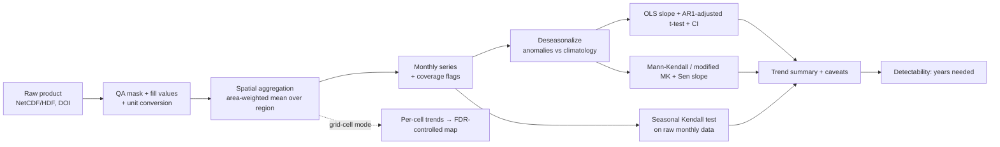

# Scientific Methods — Earth Trend Detective

Goal: answer *what is changing, where, how much, and is it significant* (the official challenge wording). Do it with methods a judge with an Earth-science background will accept, and that a student can follow.

Principle: **simple, standard, transparent methods, applied correctly.** Linear trends are explicitly in scope. The challenge says "detecting and analyzing linear trends would be a great start". The value is in handling seasonality, autocorrelation, missing data and multiple testing **honestly**.

---

## 1. Pipeline overview



---

## 2. Preparing the time series

1. **Quality control:** apply each product's fill values and quality flags (for example the MODIS QA / pixel-reliability layers). Never treat a fill value (−999, −9999, `_FillValue`) as data.
2. **Units:** convert to human-readable units and store both, for example:
   - MERRA-2 T2M: K → °C
   - IMERG: mm h⁻¹ → mm month⁻¹ (multiply by the hours in each month)
   - GLDAS fluxes: kg m⁻² s⁻¹ → mm month⁻¹
   - NDVI: unitless, after the scale factor

   Show the original unit and the conversion in the provenance panel.
3. **Spatial aggregation:**
   - Weight by grid-cell area, ∝ cos(latitude) on regular lat/lon grids.
   - For a polygon region, use the fraction of each cell inside the polygon, or at least the cell centre.
   - Report the **number of cells**. A region smaller than one cell (for example a valley inside one MERRA-2 cell of ~50 km) must trigger a warning: "region is smaller than the data resolution".
4. **Temporal resolution:** monthly by default, as the challenge recommends daily or monthly. Annual means are an optional, robust alternative that removes the seasonal cycle and most short-term autocorrelation, at the cost of a smaller *n*.
5. **Minimum length:** require **≥ 10 years** to compute a trend, and recommend ≥ 20–30 years for climate-type variables. [Judgement call. Weatherhead et al. 1998 show that the detection time depends on noise and autocorrelation; see §7.] Display *n* (months/years used) everywhere.

## 3. Seasonality

Most Earth-system variables have a strong annual cycle. Fitting a line to raw monthly data gives inflated residual variance and strong autocorrelation, and the result can be biased if the record starts and ends in different seasons.

- **Anomalies:** subtract the month-of-year climatology (the mean for each calendar month over a stated **baseline period**, for example 2001–2020, or the full record if it is shorter). Trend tests are then applied to the anomalies.
- **Seasonal Kendall test** ([Hirsch, Slack & Smith 1982](https://doi.org/10.1029/WR018i001p00107)): run the Mann-Kendall test within each calendar month and combine the results. It is robust to seasonality without needing a baseline. Run it as a second, independent check.
- Show the **climatology plot** (the mean annual cycle). It is educational and lets users see *why* deseasonalizing matters.
- **Per-season trends** (for example only DJF or JJA): an optional view. Snow and vegetation trends are often season-specific.

## 4. Trend estimation and significance

All three methods named by the challenge are offered: t-test, Mann-Kendall and confidence intervals.

### 4.1 Ordinary least squares (parametric)

- Model: anomaly(t) = a + b·t + ε. Report **b** in units per decade.
- **Autocorrelation correction** ([Santer et al. 2000](https://doi.org/10.1029/1999JD901105)): lag-1 autocorrelation r₁ of the residuals → **effective sample size** n_eff = n·(1 − r₁)/(1 + r₁). Use n_eff for the slope standard error and the t-test degrees of freedom (n_eff − 2).
- **95% confidence interval:** b ± t₀.₉₇₅,(n_eff−2)·SE_adj.
- Assumptions to state: a linear trend, roughly normal residuals, AR(1)-type noise. If n_eff < ~10, mark the result as **unreliable**.

### 4.2 Mann-Kendall (non-parametric) + Sen's slope

- **Mann-Kendall test:** monotonic trend, distribution-free, robust to outliers.
- **Sen's slope** ([Sen 1968](https://doi.org/10.1080/01621459.1968.10480934)): the median of pairwise slopes, with a rank-based confidence interval.
- **Autocorrelation:** positive serial correlation inflates MK false positives. Use the **modified MK test** of [Hamed & Rao (1998)](https://doi.org/10.1016/S0022-1694(97)00125-X) (variance correction). Pre-whitening is an alternative, but it can remove part of a real trend ([Yue & Wang 2002](https://doi.org/10.1029/2001WR000861)). We default to the Hamed-Rao variance correction and document the choice.
- Ties: use the standard tie-corrected variance (important for snow cover, which has many zero months).
- Reference implementation for cross-checking: `pymannkendall` ([Hussain & Mahmud 2019](https://doi.org/10.21105/joss.01556)), which implements original, Hamed-Rao, Yue-Wang, pre-whitening and seasonal variants.

### 4.3 Reporting rule

Report the **slope, its CI, the p-value, the test used, n and n_eff** — never just "significant / not significant". Plain-language summary template (wording reviewed for non-causal language):

> "From 2001 to 2024, mean May–September NDVI in the selected region **increased** by **0.012 per decade** (95% CI 0.004–0.020). The trend is **statistically significant** at the 5% level (modified Mann-Kendall p = 0.01, Sen's slope). **This describes a change; it does not by itself explain its cause.**"

(The numbers above are a **format example only, not a result**.)

Three-level verdict badge:
- *significant* (p < 0.05)
- *suggestive* (0.05 ≤ p < 0.10, or methods disagree)
- *not detected* (p ≥ 0.10)

Plus "**methods disagree**" when the OLS and MK conclusions differ.

## 5. Missing data

- Do **not** interpolate before testing. Mann-Kendall and OLS both work with irregular *t*; use the actual time stamps.
- Coverage rules, flagged in the UI:
  - A monthly regional value needs ≥ 50% valid area (configurable).
  - A climatology for a calendar month needs ≥ 5 years of valid values.
  - A trend needs ≥ 80% valid months, with no gap > 24 consecutive months, **or** the user must explicitly accept a warning.
- Known structural gaps must be shown on the chart: GRACE/GRACE-FO 2017–2018; IMERG Final latency; the MODIS start in 2000.

## 6. Spatial maps and multiple testing

When a trend map is computed per grid cell, thousands of tests run at once. At α = 0.05, about 5% of the cells will be "significant" **by chance**. Neighbouring cells are also correlated.

- Use the **False Discovery Rate** ([Benjamini & Hochberg 1995](https://doi.org/10.1111/j.2517-6161.1995.tb02031.x)).
- Following [Wilks (2016)](https://doi.org/10.1175/BAMS-D-15-00267.1), for spatially correlated fields use **α_FDR = 2·α_global** (for example α_FDR = 0.10 for a 5% global test).
- Map style: diverging colours for the slope. **Hatch or stipple only FDR-significant cells**, and **label the legend** "significant after FDR correction".
- Never show raw per-cell p < 0.05 stippling as the default.

## 7. Detectability — "how many more years?"

The challenge notes that a trend may become significant with a longer record. We quantify this with [Weatherhead et al. (1998)](https://doi.org/10.1029/98JD00995):

  n* ≈ [ (3.3·σ_N / |ω₀|) · √((1+φ)/(1−φ)) ]^(2/3)  (years)

where:
- ω₀ is the trend magnitude per year,
- σ_N is the standard deviation of the monthly noise (anomaly residuals),
- φ is its lag-1 autocorrelation.

This is the number of years needed to detect a trend of size ω₀ (|ω₀/σ_ω| > 2) with ~90% probability.

**[TO VERIFY]** The formula was reproduced from memory of the paper. Check it against the paper's equation before implementing. Present the result as an *estimate under the AR(1) assumption*, for example: "With this variability, a trend of this size would typically need ~N years of data to be detected."

## 8. Regional opposite trends (the challenge's highlighted point)

- The map view shows **sign and magnitude** per cell (diverging palette, centred at zero).
- The "Compare regions" panel runs the same analysis for two regions and shows both slopes and their CIs.
- Optional: a test of whether the slopes differ (difference of slopes with combined adjusted SE, as in Santer et al. 2000).
- Explanation text: the same process can produce opposite trends (for example, warming can increase snowmelt runoff in one basin and reduce snowpack in another). Phrase this **as a possibility to investigate, not a diagnosis**.

## 9. Robustness and cross-dataset agreement

A trend is more credible when independent products agree. For variables measured by more than one source:

| Quantity | Products to compare |
|---|---|
| Precipitation | IMERG (satellite + gauge) vs MERRA-2 PRECTOT (reanalysis) vs GLDAS forcing |
| Near-surface temperature | MERRA-2 T2M vs AIRS surface air temperature vs MODIS LST (*different physical quantity: skin vs air — label it*) |
| Water | GRACE TWS vs GLDAS soil moisture + SWE (rough, different quantities) |

The "agreement indicator" shows whether the slopes share a sign and whether the CIs overlap. Disagreement is reported as **uncertainty**, not hidden. Also offer a **period-sensitivity check**: does the trend survive dropping the first or last 3 years? Endpoint sensitivity is a classic overinterpretation trap.

## 10. Inhomogeneities and data-system artefacts

- Reanalysis: changes in the assimilated observing system can create spurious trends ([Gelaro et al. 2017](https://doi.org/10.1175/JCLI-D-16-0758.1) describes the MERRA-2 system).
- Satellites: sensor degradation, orbit drift, version changes (always record the collection version, for example MODIS C6.1, IMERG V07, AIRS V7).
- Event catalogs (earthquakes): detection completeness improves over time, so **raw event counts over time are not a seismicity trend**. The product will not offer a trend test on catalog counts without a completeness-magnitude cut, and even then labels it as exploratory.
- MVP scope: we do **not** implement change-point detection. If a series shows an obvious step, show a warning instead.

## 11. Correlation is not causation

- "Possible drivers" panel: show other variables for the same region side by side, with Pearson/Spearman correlation **of the detrended anomalies**. Correlating two trending series gives spurious correlation.
- Label: "**co-variation, not cause**".
- Any SI- or literature-derived hint ("regions like this often show …") must cite a source and is shown as a **hypothesis**. SI must never produce numeric results; it only routes users to catalog variables.
- Formal attribution (detection & attribution, fingerprinting) is **out of scope**, and the UI says so.

## 12. Validation of our own implementation

1. **Unit tests** against reference implementations: our OLS/MK/Sen/modified-MK/seasonal-Kendall results must match `scipy`/`statsmodels`/`pymannkendall` on fixed test series to ~1e-6.
2. **Synthetic tests:**
   - Known slope + AR(1) noise: does the CI cover the true slope ~95% of the time?
   - Zero slope + AR(1) noise: is the false-positive rate ≈ 5% with the correction, and inflated without it?
3. **External cross-check:** reproduce one area-averaged series in **NASA Giovanni** or the **NASA POWER** web UI, and show the overlay.
4. **Sanity check against literature:** large-scale MERRA-2 T2M trends should be positive over most continents in recent decades. Report any mismatch.
   - **[ASSUMPTION]** The direction is well established, but we will not quote a numeric value without a cited source.

## 13. Units and metadata carried with every result

```
variable_id, long_name, plain_definition, unit_original, unit_display, conversion,
product, version, DOI, data_kind (observation|reanalysis|model|derived),
native_resolution, region (geometry hash + name), cells_used, period, baseline,
deseasonalization, test, alpha, n, n_eff, slope, ci_low, ci_high, p_value,
coverage_fraction, warnings[], computed_at, code_version
```

Each result is reproducible from this record. "Copy citation" produces the dataset DOI citations for the user.

---

## 14. Implementation notes (added 2026-11-05, after the build)

What the code in `backend/internal/stats` and `backend/internal/analysis` actually does, and
where it differs from the plan above.

- **Implemented:** monthly anomalies (§3, baseline = selected period), Santer-adjusted OLS (§4.1;
  n_eff capped at n when r₁ ≤ 0; no test when n_eff ≤ 2.5; "unreliable" verdict when n_eff < 10),
  modified Mann-Kendall with Hamed-Rao correction and Theil-Sen slope with the scipy-style rank CI
  (§4.2), Seasonal Kendall on raw monthly values (§3), coverage rules (§5: ≥ 10 years, ≥ 80% valid
  months, no gap > 24 months), annual-mean robustness and ±3-year endpoint sensitivity (§9).
- **Verdict rule (§4.3, tightened):** "significant" only when adjusted OLS and modified MK both give
  p < α with the same sign. Reason: Monte-Carlo calibration (`calibration_test.go`, 600 series,
  n = 240, φ = 0.6) gave false-positive rates of 32% (naive OLS), 5.5% (adjusted OLS), 15.5%
  (Hamed-Rao MK alone), 5.5% (both). pymannkendall reproduces the Hamed-Rao figure (~14%);
  pre-whitening gave ~7%, Yue-Wang ~45%.
- **Practical significance:** fitted total change (slope × record length) compared with the standard
  deviation of detrended annual means. No automatic "matters / doesn't matter" judgement.
- **Not implemented:** detectability (§7, formula unverified), FDR trend maps (§6), cross-dataset
  agreement (§9), regional aggregation (§2.3), per-season trends, correlation panel (§11).
- **Validation (§12.1):** done on 4 real POWER series (Dushanbe and central Amazon; T2M and
  PRECTOTCORR), their annual means, and 2 synthetic series. Results match statsmodels/scipy/
  pymannkendall to ~1e-6.
